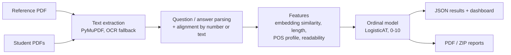

# AI Answer Sheet Grader

Upload a teacher's reference answer sheet and a class's answer sheets (PDF); get a 0–10 score per question, a class dashboard, and PDF reports for every student.

**▶ [Live demo](https://huggingface.co/spaces/Aum07/ai-answer-sheet-grader)**: click **Try the demo** to grade six sample sheets. *(Free hosting sleeps when idle; the first visit can take about a minute to wake up.)*

<!-- Add a demo GIF here: docs/demo.gif (record the upload -> results flow) -->

[](https://github.com/Aum07/ai-answer-sheet-grader/actions/workflows/ci.yml)


**Stack:** Python · FastAPI · Sentence-Transformers (all-mpnet-base-v2) · OpenAI API (structured outputs) · scikit-learn · mord (ordinal regression) · NLTK · PyMuPDF + Tesseract OCR · ReportLab · Docker · GitHub Actions

### Key findings

- A model trained on **4,500 LLM-generated answers** scored QWK 0.88 on unseen synthetic questions but only **0.31 on real student answers**, worse than plain embedding similarity.
- Retrained on **real, human-marked answers** (Mohler et al. 2011) with nested cross-validation and a new sentence-level *coverage* feature, it reaches **QWK 0.43 / Pearson 0.49** with just 5 features: about **87% of human–human agreement on QWK** (0.49) and 82% on Pearson (0.60).
- A feature ablation showed that the grammar-style and readability features which drove the synthetic results add almost nothing on real answers.
- An **LLM grader** (gpt-4o-mini, zero-shot, rubric prompt) agrees with each human marker about as well as the two markers agree with each other (mean Pearson r 0.63 vs 0.59), for **$0.05 per 2,273 answers**. Averaging it with the classic model gives the best overall agreement (QWK 0.67 vs the human average).
- **Adversarial tests broke the classic model**: a bare list of keywords scored 9.8/10 and restating the question 7.8/10. Calibrated defences cut those to **3.5 and 2.2**, while wrongly capping only **1.9% of honest answers** (QWK 0.429 → 0.426). Padding is only partly defended (see below).

---

## How it works



1. **Extract** text from each PDF page; image-only pages go through Tesseract OCR at 300 dpi. Broken font ligatures common in Word exports (`QuesƟon`, `(cid:415)`) are repaired.
2. **Parse** `Question N … Answer: …` blocks (tolerant of `Q1.`, missing colons, glued lines) and align each student answer to the reference question by number, falling back to question-text similarity. Blank answers score 0 without going through the model.
3. **Featurise** each (reference, student) pair:

   | Group | Features |
   |---|---|
   | Meaning | cosine similarity of mpnet embeddings: answer↔reference, answer↔question |
   | Length | student length ÷ reference length |
   | Grammar style | differences in noun / verb / adjective / adverb share and tag diversity, overall POS similarity |
   | Readability | Flesch–Kincaid grade ratio |
   | Coverage | share of the reference answer's sentences matched by some student sentence (mean best similarity, and share above 0.5) |

4. **Clean and check integrity** (`grader/integrity.py`): repeated and filler sentences are removed before scoring; answers that copy the question, are bare keyword lists, or answer a different question are capped and flagged for teacher review (see [Robustness](#4-robustness-to-gaming-the-grader)).
5. **Score** with an ordinal logistic model (all-threshold LogisticAT). Marks are ordered categories, so ordinal regression fits better than plain classification (it knows 6 is closer to 7 than to 2). A thin wrapper (`grader/ordinal.py`) lets it train on score sets with gaps, which real marks often have.
6. **Report**: JSON for the web UI, plus per-student PDFs and a class ZIP with a summary.

## Data

| Dataset | Answers | Questions | Labels | Role |
|---|---|---|---|---|
| **Synthetic** (`data/synthetic/`) | 4,500 | 1,496, mixed subjects | LLM-assigned target score 0–10, ~400 per level | Original training set |
| **Mohler et al. 2011** ([nkazi/MohlerASAG](https://huggingface.co/datasets/nkazi/MohlerASAG), CC BY 4.0) | 2,273 | 79, CS / data structures | Two human graders, 0–5 (averaged, ×2 → 0–10) | Real-world evaluation and training |

For the synthetic set, questions came from the web or an LLM, and an LLM wrote a reference answer plus student answers in different styles and quality levels. A model trained on it learns how an LLM *imitates* a weak or strong answer, which the results below show is not the same as how humans mark.

Mohler answers are real student responses from a University of North Texas course. Exercises graded out of 10 are rescaled to 0–5 before averaging (`scripts/prepare_mohler.py`).

## Results

All splits hold out **whole questions**, so every number is for questions the model never saw during training. Metrics: QWK (quadratic weighted kappa, the standard agreement measure in automated scoring), Pearson r on the 0–5 scale (as reported in the Mohler paper), MAE on 0–10, and the share of predictions within ±1 mark.

### 1. Synthetic data (`python scripts/train.py`)

225 held-out questions (675 answers); 1,047 questions for training.

| Model | QWK | MAE | Within ±1 |
|---|---|---|---|
| Predict the mean | – | 2.71 | 29% |
| Embedding similarity only | 0.677 | 1.68 | 52% |
| **LogisticAT, 10 features** | **0.877** | 1.14 | 72% |
| Ridge (rounded) | 0.864 | 1.18 | 69% |
| Gradient boosting (rounded) | 0.881 | 1.11 | 75% |

The original project used a random split of answers (QWK 0.894). Holding out whole questions costs little, and gradient boosting's small lead is within noise and overfits more (train/test QWK 0.911/0.881 vs 0.882/0.877).

### 2. Real student answers (`python scripts/evaluate_mohler.py`)

5-fold cross-validation grouped by question, against the average of the two human graders.

| | QWK | Pearson r (0–5) | MAE | Within ±1 |
|---|---|---|---|---|
| *Human vs human (grader 1 vs grader 2)* | *0.491* | *0.597* | *1.50* | *59%* |
| Synthetic-trained model, applied as-is | 0.312 | 0.323 | 1.94 | 55% |
| Embedding similarity only (fit on Mohler) | 0.333 | 0.429 | 1.49 | 61% |
| Trained on synthetic + Mohler | 0.370 | 0.374 | 1.69 | 58% |
| **Trained on Mohler** | **0.421** | **0.476** | 1.32 | 66% |

- **Synthetic training doesn't transfer.** On real answers the synthetic model is worse than a one-feature similarity baseline, and adding synthetic data to real data *lowers* performance.
- **Calibration isn't the problem, ranking is.** Humans average 8.4/10 and the synthetic model 8.1, both scoring 72% of answers 8+. The model just can't tell which real answers are better.
- **Why every QWK here is lower:** 72% of real answers score 8+, so the range is compressed. That depresses QWK even between the two humans, so the human–human row, not 1.0, is the ceiling to compare against.

### 3. Feature ablation on real answers (`python scripts/tune_mohler.py`)

Nested CV: `alpha` is chosen inside each training fold (grid 0.1–100), never on test questions. Features are computed on cleaned answers.

| Feature set | # | QWK | Pearson r |
|---|---|---|---|
| **Meaning + length + coverage (selected)** | 5 | **0.429** | **0.491** |
| All except readability, + coverage | 11 | 0.429 | 0.484 |
| All 10 + coverage | 12 | 0.428 | 0.483 |
| All 10 original features | 10 | 0.421 | 0.477 |
| Meaning + length | 3 | 0.417 | 0.482 |
| Without length | 9 | 0.378 | 0.436 |
| Meaning + coverage | 4 | 0.368 | 0.437 |
| Answer–reference similarity only | 1 | 0.357 | 0.433 |
| *Human vs human* | | *0.491* | *0.597* |

- **Length is the most useful feature after meaning** (removing it costs 0.04 QWK); in real answers, longer usually means more complete.
- **Coverage helps a little and makes the model simpler**: 5 features match or beat 12.
- **Grammar-style and readability features barely matter on real data**, unlike on synthetic data, where they lifted QWK from 0.68 to 0.88. That gap is the clearest sign the synthetic model learned the generator's writing style.

**Shipped model** (`models/mohler/`): the selected 5 features, `alpha` re-chosen by grouped CV on all data, then fitted on all 2,273 answers. The synthetic model is kept in `models/synthetic/` for comparison.

### 4. Robustness to gaming the grader

`python scripts/adversarial_eval.py` takes 150 real answers that humans scored ≤ 7/10, applies each attack, and compares scores with the defences off and on (shipped Mohler model).

| Attack | Ideal | Mean score: no defences | With defences | Capped / flagged |
|---|---|---|---|---|
| *Original answers* | | 8.30 | 8.15 | 3% / 7% |
| Keyword list (15 terms, no sentences) | no increase | **9.83** | **3.47** | 81% / 81% |
| Restating the question | decrease | **7.83** | **2.19** | 97% / 97% |
| Answer to another question on the same sheet | decrease | 6.79 | 5.77 | 25% / 55% |
| Padding with ~70 words of filler | no increase | 9.47 | 8.78 | 1% / 7% |
| Same answer written twice | no increase | 8.67 | 8.25 | 3% / 7% |
| First half only | decrease | 7.36 | 7.11 | 5% / 14% |
| Copying the reference (control) | increase | 10.00 | 10.00 | 0% / 0% |

**Defences** (`grader/integrity.py`), with thresholds calibrated on half the Mohler questions at fixed false-positive rates and reported on the other half (`python scripts/calibrate_integrity.py`):

| Defence | On honest answers | Effect |
|---|---|---|
| Remove repeated and filler sentences | keeps 97.7% of honest sentences | removes 60% of filler sentences (a filler set separate from the attack's) |
| Copies-the-question check | 0.4% false positives | catches 97% |
| Keyword-list check | 0.7% false positives | catches 81% |
| Off-topic, high confidence (score capped) | 0.8% false positives | catches 30% of wrong-question answers |
| Off-topic, possible (review flag only) | 2.9% false positives | catches 60% |

Across all real answers, 1.9% are capped, and their human score averages 6.0 vs 8.4 for the rest. Agreement with humans barely moves (QWK 0.429 → 0.426).

**What's still open:**
- **Padding and repetition only partly defended.** Some filler sentences are close enough to the topic to survive cleaning.
- **Truncation is barely penalised.** The model doesn't really know what a complete answer looks like.
- **Wrong-question answers on the same sheet are hard to catch**, because questions in one assignment overlap heavily (stacks vs queues). The off-topic check trades catch rate for very few false alarms on honest students.

These are limits of similarity-based features, and they're what the planned LLM rubric grader is meant to address, measured on the same benchmark.

### 5. LLM grader vs classic model (`python scripts/evaluate_llm.py --attacks`)

`grader/llm_grader.py` sends all answers to a question in one request, with a rubric prompt (0–10 bands; don't reward length, repetition, filler, restated questions or keyword lists) and a JSON schema for the reply. It returns a score **and written feedback** per answer. No Mohler examples are used in the prompt (zero-shot). The classic model's numbers are question-grouped cross-validation predictions on the same answers.

**Agreement with each human marker separately** (the fair comparison: averaging two markers removes some of their noise, which would flatter any model compared with the average):

| | r vs marker 1 | r vs marker 2 | QWK vs marker 1 | QWK vs marker 2 |
|---|---|---|---|---|
| *Marker 1 vs marker 2* | *0.59* | | *0.49* | |
| Classic model (5 features) | 0.47 | 0.43 | 0.45 | 0.30 |
| **LLM (gpt-4o-mini)** | 0.55 | **0.71** | 0.32 | **0.61** |
| **Hybrid (mean of both)** | **0.58** | 0.69 | **0.48** | **0.63** |

**Against the average of both markers:**

| | QWK | Pearson r (0–5) | MAE | Within ±1 | Mean score |
|---|---|---|---|---|---|
| Classic model | 0.431 | 0.492 | 1.30 | 66% | 8.9 |
| LLM | 0.505 | 0.718 | 2.31 | 43% | 6.2 |
| **Hybrid** | **0.668** | **0.720** | **1.29** | 60% | – |
| *Humans* | | | | | *8.4* |

- **The LLM ranks answers far better** than the feature model (r 0.72 vs 0.49), at human-marker level.
- **But it is harsher than these markers** (mean 6.2 vs 8.4), hence its larger MAE. The hybrid combines the LLM's ranking with the classic model's calibration and is best on almost every measure.
- **Cost and speed:** 152 API calls for 2,273 answers, ~$0.05 in total (about $0.02 per 1,000 answers), with 8 requests in parallel.

**Under attack** (same 150 weak answers and attacks as section 4):

| Attack | Classic, no defences | Classic + defences | **LLM** |
|---|---|---|---|
| *Original answers* | 8.30 | 8.15 | **3.37** |
| Padding | 9.47 | 8.78 | **2.35** |
| Repetition | 8.67 | 8.25 | **3.45** |
| Restating the question | 7.83 | 2.19 | **0.00** |
| Keyword list | 9.83 | **3.47** | 5.97 |
| Answer to another question | 6.79 | 5.77 | **0.39** |
| First half only | 7.36 | 7.11 | **2.23** |
| Copy of the reference | 10.00 | 10.00 | 10.00 |

The LLM resists padding, repetition, off-topic and restated answers, which were exactly the classic model's open weaknesses, and correctly scores these weak answers low (3.4 vs 8.3). Its one weakness, **keyword lists** (32% still score 8+), is the attack the integrity checks catch best (81%). So the two approaches are complementary.

**Caveats:**
- Mohler has been public since 2011, so an LLM may have seen it during training. The results could be optimistic for unseen material.
- One model and one prompt version (`v1`), temperature 0, no prompt tuning on this data.
- Scores and feedback come from a third-party API: answers are sent to OpenAI, which matters for real student data under GDPR.

## Quick start

```bash
git clone https://github.com/Aum07/ai-answer-sheet-grader.git
cd ai-answer-sheet-grader
python -m venv .venv && source .venv/bin/activate      # Windows: .venv\Scripts\activate
pip install -r requirements.txt
uvicorn app.main:app --reload
```

Open http://127.0.0.1:8000, upload `samples/ai/reference.pdf` and a few `samples/ai/student_*.pdf`, and click **Evaluate**. The first run downloads the embedding model (~420 MB). OCR on scanned pages needs [Tesseract](https://github.com/tesseract-ocr/tesseract).

Use the synthetic model instead with `MODEL_NAME=synthetic` (PowerShell: `$env:MODEL_NAME="synthetic"`).

**Docker:**

```bash
docker build -t answer-grader .
docker run -p 8000:7860 answer-grader        # then open http://localhost:8000
```

**API:** interactive docs at `/docs`.

```bash
curl -X POST http://127.0.0.1:8000/evaluate/ \
  -F reference_pdf=@samples/ai/reference.pdf \
  -F student_pdfs=@samples/ai/student_01.pdf \
  -F student_pdfs=@samples/ai/student_02.pdf
```

| Endpoint | Purpose |
|---|---|
| `POST /evaluate/` | Grade a reference PDF + up to 30 student PDFs |
| `GET /download/{request_id}?student=Name` | One student's PDF report |
| `GET /download-multiple/{request_id}` | ZIP of all reports + class summary |
| `GET /health` | Liveness, whether the model is loaded, and which one |

Configuration is via environment variables (see `.env.example`): model choice, optional API key, upload limits, rate limit, CORS origins.

## Reproduce the results

```bash
pip install -r requirements-dev.txt
python scripts/train.py               # synthetic: features (cached), models, reports/metrics_synthetic.json
python scripts/prepare_mohler.py      # download + convert the human-marked dataset
python scripts/evaluate_mohler.py     # transfer experiment -> reports/mohler_metrics.json
python scripts/calibrate_integrity.py # defence thresholds at fixed false-positive rates -> models/integrity.json
python scripts/tune_mohler.py         # ablation + nested CV, saves models/mohler/
python scripts/adversarial_eval.py    # attacks with defences off vs on -> reports/adversarial.json
$env:OPENAI_API_KEY = "sk-..."        # PowerShell (bash: export OPENAI_API_KEY=...)
python scripts/evaluate_llm.py --attacks   # LLM vs classic vs hybrid, + attacks (~$0.10, cached)
pytest
```

Embedding is the slow step (a few minutes on CPU); features are cached in `data/processed/`, so the experiments after that take seconds to a minute.

## Project layout

```
grader/        core library: extraction, features, integrity checks, ordinal model, scoring, pipeline, reports
app/           FastAPI service + static web UI
scripts/       training, Mohler download / evaluation / tuning
models/        mohler/ (default) and synthetic/: model, scaler, model card; integrity.json thresholds
reports/       metrics JSON for every experiment
data/          synthetic training data (Mohler is downloaded, not committed)
samples/       anonymised sample sheets (5 subjects, 89 students) + manifest.csv
notebooks/     original exploratory notebook (model comparison, tuning, bias analysis)
tests/         pytest suite (pipeline runs with a fake embedder, so no downloads in CI)
```

## Limitations and responsible use

- **Modest agreement with humans.** Even the best model reaches ~80–86% of human–human agreement on one course's CS questions. Results on other subjects are untested.
- **Can still be gamed.** Padding, repetition and wrong-question answers are only partly defended (see Robustness). Flagged answers need a teacher's review.
- **Feedback in the app is still generic.** The LLM grader writes specific feedback, but isn't wired into the web app yet.
- **Layout assumptions.** Sheets must label questions `Question N` / `QN` and answers `Answer:`. Tesseract OCR on handwriting is limited.
- **Human in the loop.** Under the EU AI Act, AI systems used to evaluate learning outcomes are classed as *high-risk*. This tool is meant to **assist** a marker (triage, consistency checks), not to issue final grades. Uploads are processed in a temporary directory and deleted after each request; results stay in memory for one hour for report downloads.

## Roadmap

- [x] Evaluate on human-marked data (Mohler et al. 2011) against the human–human ceiling
- [x] Feature ablation and nested-CV tuning on real answers
- [x] Adversarial tests and calibrated defences (copying the question, keyword lists, filler, off-topic)
- [x] LLM rubric grader with per-answer feedback, benchmarked on Mohler for agreement, cost and robustness
- [ ] LLM grader and hybrid as options in the web app (with the integrity checks on top)
- [ ] Calibrate LLM scores to the marking scale on training questions
- [ ] Background grading jobs with live progress for large classes
- [ ] Handwriting OCR (TrOCR or a vision model) with character error rate on scanned sheets
- [ ] Hosted demo on Hugging Face Spaces

## Citation

The real-data experiments use:

> Michael Mohler, Razvan Bunescu and Rada Mihalcea. 2011. *Learning to Grade Short Answer Questions using Semantic Similarity Measures and Dependency Graph Alignments.* ACL 2011, pp. 752–762. https://aclanthology.org/P11-1076

Dataset obtained from [huggingface.co/datasets/nkazi/MohlerASAG](https://huggingface.co/datasets/nkazi/MohlerASAG) (CC BY 4.0).

## Background

Started as my final-year BTech project at D Y Patil International University (2025); rebuilt with a tested package structure, reproducible training, evaluation on real human-marked data and deployment tooling.

**Author:** Aum Kanakiya · [LinkedIn](https://www.linkedin.com/in/aum-kanakiya-94aa59250/)
