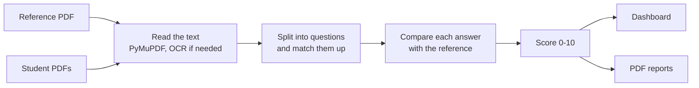

# AI Answer Sheet Grader

**In short:** you upload a teacher's answer sheet and a class's answer sheets as PDFs, and the app gives each answer a score out of 10, a class dashboard, and a PDF report for every student.

- **What I found:** training on AI-generated answers looks great on paper but falls apart on real students. Retraining on 2,273 real, teacher-marked answers fixed most of that.
- **Best result:** combining a small classic model with an LLM agrees with human markers better than the two markers agree with each other (QWK 0.67 vs 0.49).
- **I also tried to cheat it.** A list of keywords originally scored 9.8/10. After adding checks, it scores 3.5.
- **▶ [Try the live demo](https://huggingface.co/spaces/Aum07/ai-answer-sheet-grader)** (free hosting, so the first load can take about a minute).


[](https://github.com/Aum07/ai-answer-sheet-grader/actions/workflows/ci.yml)


**Built with:** Python, FastAPI, Sentence-Transformers (all-mpnet-base-v2), OpenAI API, scikit-learn, mord, NLTK, PyMuPDF, Tesseract OCR, ReportLab, Docker, GitHub Actions

---

## Why I built this

Marking written exam answers takes teachers hours, and two teachers marking the same answer often give different scores. I wanted to see how close a computer could get to a human marker, and, just as important, where it goes wrong.

This started as my final-year BTech project at D Y Patil International University (2025). Since then I've rebuilt it properly: a tested code structure, reproducible experiments, testing on real marked answers, and a deployed demo.

## How it works



1. **Read the PDFs.** Text is pulled from each page. Scanned pages go through OCR. Some Word exports break letters in odd ways (`QuesƟon` instead of `Question`), so those get repaired.
2. **Match questions.** The app finds each `Question N … Answer: …` block and pairs every student answer with the right question in the reference. Blank answers get 0 straight away.
3. **Measure each answer.** For every answer it works out a handful of numbers:
   - **Meaning:** how close the answer is in meaning to the reference answer (and to the question), using sentence embeddings.
   - **Length:** how long it is compared with the reference.
   - **Coverage:** how many of the reference's key sentences the student actually covered.
   - Grammar-style and readability measures (these turned out not to help on real answers; more on that below).
4. **Check for cheating.** Repeated sentences and filler are stripped out. Answers that just copy the question, are only a list of keywords, or answer a different question get capped and flagged for the teacher.
5. **Score it.** An ordinal regression model turns those numbers into a mark from 0 to 10. "Ordinal" just means it knows a 6 is closer to a 7 than to a 2, which a normal classifier doesn't.
6. **Report.** Results show up in the web app, and you can download a PDF per student or a ZIP for the whole class.

## The data

| Dataset | Answers | Questions | Who marked it | Used for |
|---|---|---|---|---|
| **Synthetic** (`data/synthetic/`) | 4,500 | 1,496, many subjects | An LLM | The original version of the project |
| **Mohler et al. 2011** ([link](https://huggingface.co/datasets/nkazi/MohlerASAG), CC BY 4.0) | 2,273 | 79, computer science | Two human teachers | Real-world testing and training |

The synthetic set was made by asking an LLM to write a reference answer and then student answers of different quality. The Mohler set is real answers from students at the University of North Texas, each marked by two teachers.

That difference turned out to be the most important thing in this project.

## What I found

### How to read the numbers

The main score I use is **QWK** (quadratic weighted kappa). It measures how well two markers agree. 1.0 means they always agree, 0 means no better than chance, and being off by a lot is punished more than being off by a little.

One important point: **even the two human teachers only reach QWK 0.49 with each other.** So that, not 1.0, is the realistic target. A model that matches 0.49 is marking about as consistently as a second teacher would.

In every test, the model is scored on questions it never saw during training.

### 1. AI-generated training data doesn't transfer to real students

On synthetic data, the model looked excellent: **QWK 0.88** on unseen questions.

On real student answers, the same model dropped to **QWK 0.31**. That's worse than just measuring how similar the answer is to the reference (0.33).

| Model, tested on real answers | QWK | Pearson r |
|---|---|---|
| *Teacher 1 vs teacher 2* | *0.49* | *0.60* |
| Trained on synthetic data only | 0.31 | 0.32 |
| Similarity to the reference only | 0.33 | 0.43 |
| Trained on synthetic + real data | 0.37 | 0.37 |
| **Trained on real data only** | **0.42** | **0.48** |

Adding synthetic data to the real data actually made things worse. My explanation: the synthetic model learned how an LLM *pretends* to write a weak or strong answer, not how real students write or how teachers mark.

Interestingly, the synthetic model's average score was about right (8.1 vs the teachers' 8.4). It just couldn't tell which real answers were better than others.

### 2. Simpler was better

I tested which measurements actually matter on real answers (with nested cross-validation, so tuning never touched the test questions).

| What the model uses | Number of features | QWK |
|---|---|---|
| **Meaning + length + coverage** | **5** | **0.43** |
| Everything | 12 | 0.43 |
| Meaning + length | 3 | 0.42 |
| Everything except length | 9 | 0.38 |
| Similarity only | 1 | 0.36 |

- **Length matters most after meaning.** In real answers, longer usually means more complete.
- **Grammar style and readability barely helped at all on real answers**, even though they were the reason the synthetic model scored so high. That was the clearest sign it had learned the LLM's writing style rather than what makes an answer good.

So the shipped model (`models/mohler/`) uses just those 5 features. That gets it to about **87% of the agreement the two teachers have with each other**.

### 3. I tried to game it, and it broke

I took 150 real answers that teachers marked 7/10 or lower, then changed them the way a student trying to game the system might.

| Trick | Should the score... | Before defences | After defences |
|---|---|---|---|
| *Original answer* | | 8.30 | 8.15 |
| Just a list of 15 keywords | not go up | **9.83** | **3.47** |
| Restating the question | go down | **7.83** | **2.19** |
| Answer to a different question | go down | 6.79 | 5.77 |
| Adding ~70 words of filler | not go up | 9.47 | 8.78 |
| Writing the answer twice | not go up | 8.67 | 8.25 |
| Only the first half | go down | 7.36 | 7.11 |
| Copying the reference (sanity check) | go up | 10.00 | 10.00 |

A list of keywords scoring nearly full marks was a real problem. So I added checks in `grader/integrity.py`, and set their thresholds so they almost never punish honest students:

| Check | Wrongly flags honest answers | Catches |
|---|---|---|
| Copies the question | 0.4% | 97% |
| Just a keyword list | 0.7% | 81% |
| Clearly off-topic (score capped) | 0.8% | 30% |
| Possibly off-topic (flag for the teacher only) | 2.9% | 60% |
| Remove repeated / filler sentences | keeps 97.7% of real sentences | removes 60% of filler |

Overall, only 1.9% of real answers get capped, and those answers had a much lower teacher score on average (6.0 vs 8.4), so the checks are mostly catching weak answers. Agreement with teachers barely changed (0.429 → 0.426).

**Still not solved:** filler that's close to the topic, cutting an answer in half, and answering a neighbouring question (like stacks vs queues on the same sheet). Similarity-based scoring just can't tell these apart well. That's why I tried an LLM next.

### 4. An LLM grader, and combining the two

I gave gpt-4o-mini a marking guide (score bands from 0 to 10, plus "don't reward length, repetition, filler, restating the question or keyword lists") and asked it to score every answer and write feedback. I gave it no examples from the dataset.

**Compared with each teacher separately:**

| | Agreement with teacher 1 (r) | Agreement with teacher 2 (r) |
|---|---|---|
| *Teacher 1 vs teacher 2* | *0.59* | |
| Classic model | 0.47 | 0.43 |
| LLM | 0.55 | **0.71** |
| **Average of both** | **0.58** | 0.69 |

**Compared with the teachers' average:**

| | QWK | Pearson r | Average error (out of 10) | Average score |
|---|---|---|---|---|
| Classic model | 0.43 | 0.49 | 1.30 | 8.9 |
| LLM | 0.51 | 0.72 | 2.31 | 6.2 |
| **Average of both** | **0.67** | **0.72** | **1.29** | |
| *Teachers* | | | | *8.4* |

What this means in plain terms:

- **The LLM is much better at ranking answers** from best to worst, about as good as a human teacher.
- **But it's a stricter marker** than these teachers (average 6.2 vs 8.4).
- **Averaging the two gets the best of both:** the LLM's sense of which answers are better, and the classic model's sense of what score teachers actually give.
- **It's cheap:** about $0.05 to mark all 2,273 answers.

The LLM also handled most of the tricks that fooled the classic model:

| Trick | Classic + defences | LLM |
|---|---|---|
| *Original weak answers* | 8.15 | **3.37** |
| Filler | 8.78 | **2.35** |
| Repeating the answer | 8.25 | **3.45** |
| Restating the question | 2.19 | **0.00** |
| Keyword list | **3.47** | 5.97 |
| Answer to another question | 5.77 | **0.39** |
| First half only | 7.11 | **2.23** |

Its one weak spot is keyword lists, which happens to be exactly what the integrity checks catch best. So the two approaches cover each other.

**Things to keep in mind:**
- The Mohler dataset has been public since 2011, so the LLM may have seen it in training. Results on brand-new questions could be lower.
- I tested one model with one prompt and didn't tune the prompt on this data.
- The LLM route sends student answers to OpenAI, which matters under GDPR for real student data.

## Try it yourself

```bash
git clone https://github.com/Aum07/ai-answer-sheet-grader.git
cd ai-answer-sheet-grader
python -m venv .venv && source .venv/bin/activate      # Windows: .venv\Scripts\activate
pip install -r requirements.txt
uvicorn app.main:app --reload
```

Open http://127.0.0.1:8000, upload `samples/ai/reference.pdf` and a few `samples/ai/student_*.pdf` files, and click **Evaluate**. The first run downloads the embedding model (~420 MB). Scanned pages need [Tesseract](https://github.com/tesseract-ocr/tesseract) installed.

The app uses the model trained on real answers by default. To use the synthetic one instead, set `MODEL_NAME=synthetic` (PowerShell: `$env:MODEL_NAME="synthetic"`). The live demo uses the synthetic model, since people can upload sheets from any subject and the real-data model has only seen computer science.

**With Docker:**

```bash
docker build -t answer-grader .
docker run -p 8000:7860 answer-grader        # then open http://localhost:8000
```

**API** (full docs at `/docs`):

```bash
curl -X POST http://127.0.0.1:8000/evaluate/ \
  -F reference_pdf=@samples/ai/reference.pdf \
  -F student_pdfs=@samples/ai/student_01.pdf \
  -F student_pdfs=@samples/ai/student_02.pdf
```

| Endpoint | What it does |
|---|---|
| `POST /evaluate/` | Grade a reference PDF and up to 30 student PDFs |
| `GET /download/{request_id}?student=Name` | One student's PDF report |
| `GET /download-multiple/{request_id}` | ZIP with every report and a class summary |
| `GET /health` | Check the app is running and which model is loaded |

Settings (model, API key, upload limits, rate limit, CORS) are environment variables; see `.env.example`.

## Reproduce the results

```bash
pip install -r requirements-dev.txt
python scripts/train.py               # synthetic model
python scripts/prepare_mohler.py      # download the real, teacher-marked answers
python scripts/evaluate_mohler.py     # does the synthetic model work on real answers?
python scripts/calibrate_integrity.py # set the cheating-check thresholds
python scripts/tune_mohler.py         # feature comparison, trains the shipped model
python scripts/adversarial_eval.py    # the gaming tests
export OPENAI_API_KEY=...             # PowerShell: $env:OPENAI_API_KEY = "sk-..."
python scripts/evaluate_llm.py --attacks   # LLM vs classic vs combined (~$0.10)
pytest
```

The slow part is computing embeddings (a few minutes on a CPU). They're cached, so everything after that takes under a minute. Every result is saved as JSON in `reports/`.

## What's in the repo

```
grader/      the core: reading PDFs, features, cheating checks, model, scoring, reports
app/         FastAPI app and web interface
scripts/     training and every experiment above
models/      the real-data model (default), the synthetic model, and check thresholds
reports/     results of every experiment, as JSON
data/        synthetic training data (the real dataset is downloaded, not stored here)
samples/     anonymised sample sheets: 5 subjects, 89 students
notebooks/   the original exploration notebook
tests/       tests (these use a fake embedding model, so CI needs no downloads)
```

## Limits and responsible use

- **It's an assistant, not a replacement for a teacher.** Even the best version only gets close to how well two teachers agree, and only on one computer science course. Other subjects are untested.
- **It can still be gamed** in some of the ways shown above. Flagged answers need a teacher to look at them.
- **The web app's feedback is still generic.** The LLM writes specific feedback, but it isn't in the app yet.
- **Sheets need a set layout:** questions labelled `Question N` or `QN`, and answers labelled `Answer:`. OCR on handwriting is weak.
- **Under the EU AI Act, AI used to assess students counts as high-risk.** This tool is meant to help a teacher (spot inconsistencies, sort answers for review), not to hand out final grades on its own. Uploaded files are deleted after each request, and results are kept in memory for one hour so reports can be downloaded.

## Roadmap

- [x] Test on real, teacher-marked answers
- [x] Compare features and tune properly on real answers
- [x] Try to game the grader and add defences
- [x] LLM grader with written feedback, tested on the same data
- [x] Live demo on Hugging Face Spaces
- [ ] Offer the LLM and combined grader in the web app
- [ ] Adjust LLM scores to match how teachers actually mark
- [ ] Background grading with a progress bar for large classes
- [ ] Better handwriting recognition

## Citation

The real-data experiments use:

> Michael Mohler, Razvan Bunescu and Rada Mihalcea. 2011. *Learning to Grade Short Answer Questions using Semantic Similarity Measures and Dependency Graph Alignments.* ACL 2011, pp. 752–762. https://aclanthology.org/P11-1076

Dataset from [huggingface.co/datasets/nkazi/MohlerASAG](https://huggingface.co/datasets/nkazi/MohlerASAG) (CC BY 4.0).

---

**Aum Kanakiya** · [LinkedIn](https://www.linkedin.com/in/aum-kanakiya-94aa59250/)
